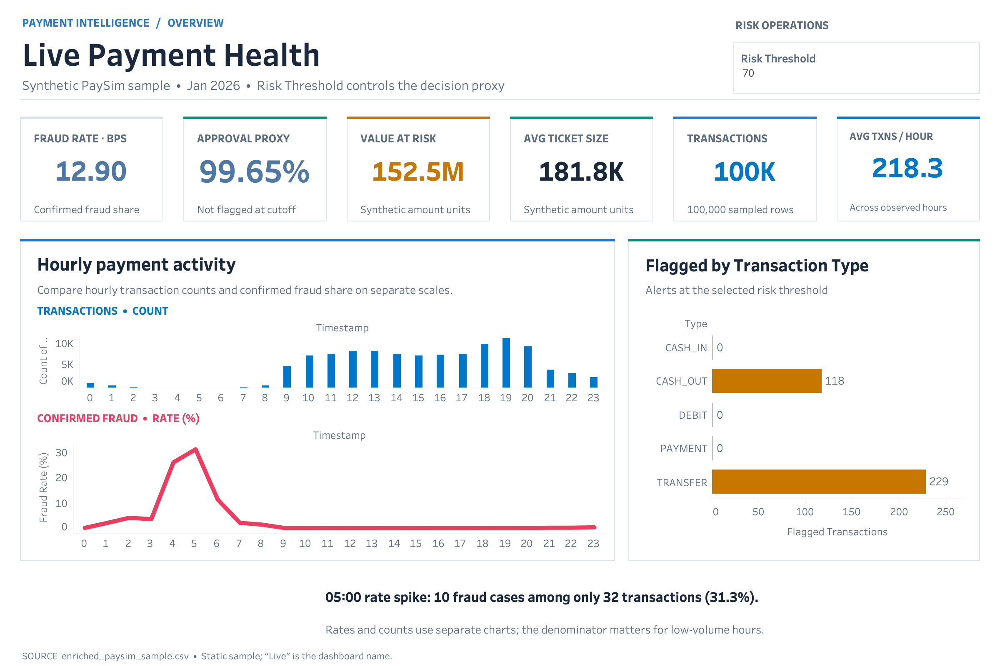
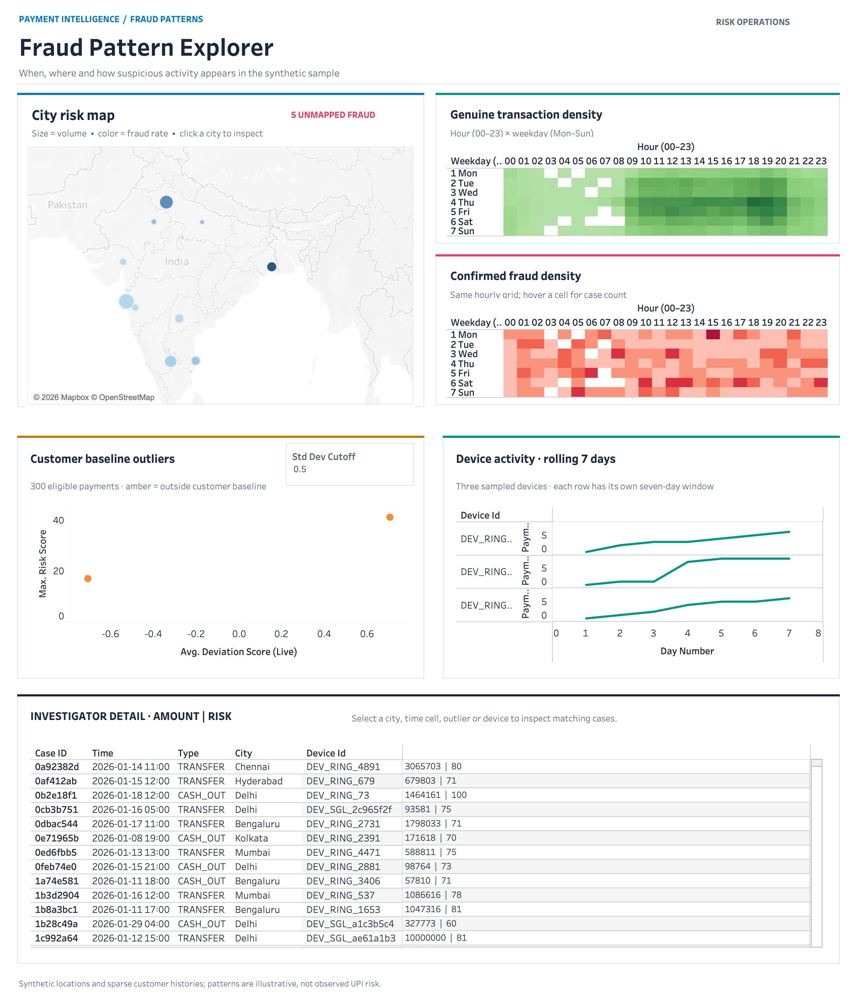
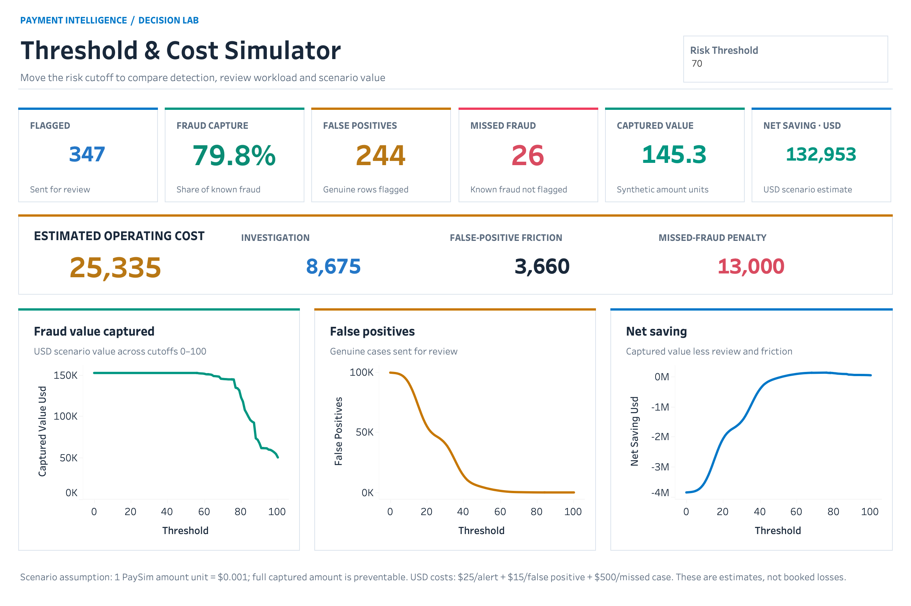

<div align="center">

# Payment Intelligence
### A closer look at digital payment fraud

Python · Tableau · PaySim

[Open the workbook](https://drive.google.com/file/d/1dSqNUd8UPy9T0P0-8QZTpnKwPrAkOcEj/view) · [Project files & datasets](https://drive.google.com/drive/folders/1vOo2HqN-Q355i5EWTVKRFJAgq2PB90vE) · [Read the project notes](docs/PROJECT_HANDOFF.md)

</div>

---

A payment looks unusual. Should it go through, or should someone review it?

This project explores that decision through three Tableau dashboards. It brings together payment activity, fraud patterns and a threshold simulator so you can see how a small change in the cutoff affects the review queue.

| Payments explored | Labelled fraud | Sample fraud rate |
| ---: | ---: | ---: |
| 100,000 | 129 | 0.129% |

## Take a look



**Live Payment Health** puts the main numbers in one place. Follow hourly activity, check confirmed fraud rates and see which transaction types create review alerts. Move the risk slider to watch the approval proxy change.

<details>
<summary>Explore patterns across time, cities and devices</summary>



**Fraud Pattern Explorer** brings together a city map, weekday and hour heatmaps, customer history exploration and investigator details. It helps move from a broad pattern to individual cases.

</details>

<details>
<summary>See the threshold trade-off</summary>



**Threshold & Cost Simulator** compares captured fraud, false positives, missed cases and estimated economics across cutoffs from 0 to 100.

</details>

These are saved preview exports from the project build. Download the latest TWBX for the current interactive views and labels.

## What stood out

- **A high rate needs context.** At 05:00, 10 fraud cases among 32 payments create a 31.3% rate. The payment count explains the spike.
- **More reviews have a cost.** At cutoff 70, the rule flags 347 payments and captures 103 of the 129 labelled fraud cases.
- **The cutoff changes the balance.** At 76, alerts fall to 198 and false positives fall to 101, while captured fraud falls to 97 cases.
- **The economics depend on the assumptions.** Cutoff 76 gives the highest estimated net saving in this sample under the project's stated cost model.

## Open it yourself

1. Download **Payment Fraud Monitor - Final.twbx** using the workbook link above.
2. Open it in Tableau Desktop. The sample and supporting dependencies are packaged inside.
3. Start with Live Payment Health, try the risk slider, then explore the simulator and patterns.

The editable workbook definition is in [tableau/](tableau/). Use the TWBX download for the version with embedded data. Drive access follows the folder owner's sharing permissions.

## Under the hood

The Python pipeline enriches PaySim transactions with time fields, customer baselines, synthetic city and device information, and a 0–100 score. Tableau turns those prepared fields into interactive views, calculations and scenario comparisons.

To reproduce the preparation, download the original paysim.csv from the Drive backup, place it beside pipeline.py, install pandas and numpy, and run:

```sh
python pipeline.py
```

Generated files go into output/. Re-running can regenerate transaction IDs. Use the saved workbook to reproduce the submitted dashboard figures.

| Folder or file | What is inside |
| --- | --- |
| [pipeline.py](pipeline.py) | Original enrichment and scoring pipeline |
| [tableau/](tableau/) | Latest editable Tableau workbook definition |
| [data/](data/) | Field dictionary and cost assumptions |
| [docs/](docs/) | Project explanation and recorded validation |
| [assets/](assets/) | Dashboard previews |
| [Drive backup](https://drive.google.com/drive/folders/1vOo2HqN-Q355i5EWTVKRFJAgq2PB90vE) | Packaged workbook, full datasets, reports and restore guide |

## A few things to know

This is an academic project built on synthetic PaySim data. Cities and devices were generated for exploration. The score includes the known fraud label, creating **label leakage**, so the capture figures cannot establish independent predictive performance.

“Approval proxy” means the share passing the selected review rule. The USD simulator uses an illustrative conversion of $0.001 per PaySim amount unit and explicit review costs. Its savings are scenario estimates.

Full datasets are stored in Drive as split ZIP archives with a restore guide. The sample workbook, code and documentation represent the latest project version.

---

<div align="center">
Built to make the trade-off between detection, workload and customer friction easier to see.
</div>
